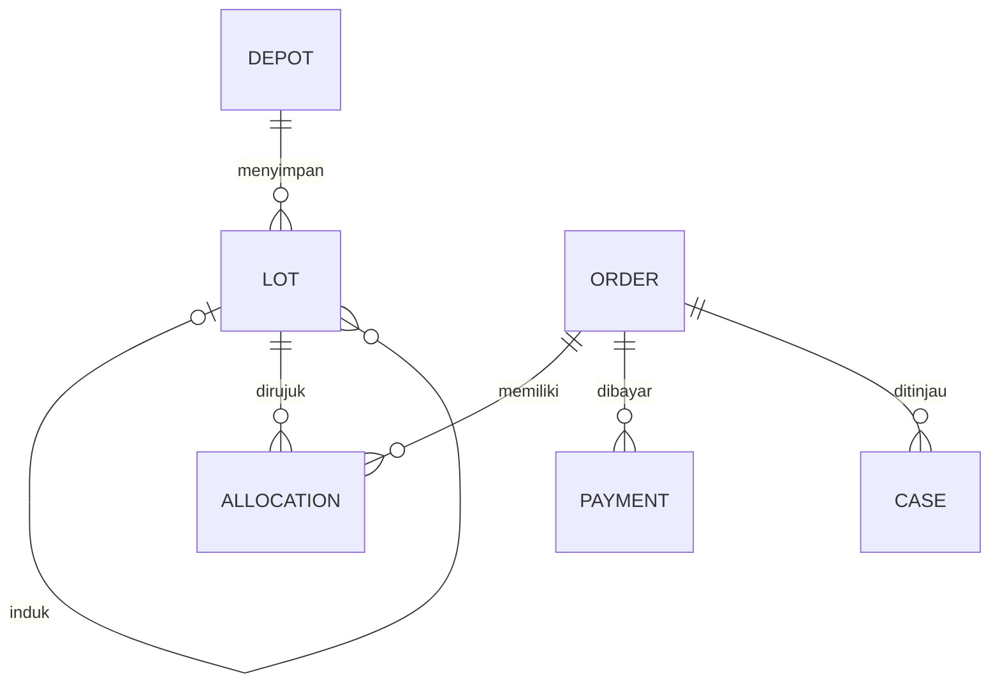
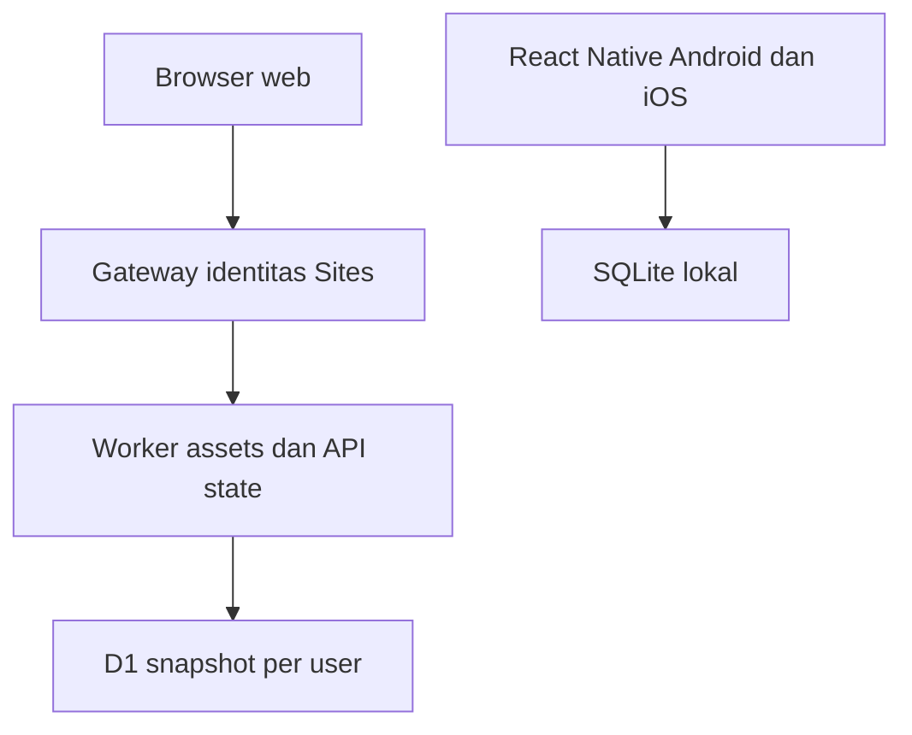

# Diagram teknis TelurFarm 5.0

Diagram relasi berikut bersifat logis di payload JSON, bukan tabel SQL terpisah.

Tidak ada koneksi sinkron native ke Worker pada rilis ini. Browser juga memakai penyimpanan lokal; preferensi filter berada di localStorage. SQLite native memakai app_state dan app_preferences secara terpisah.
